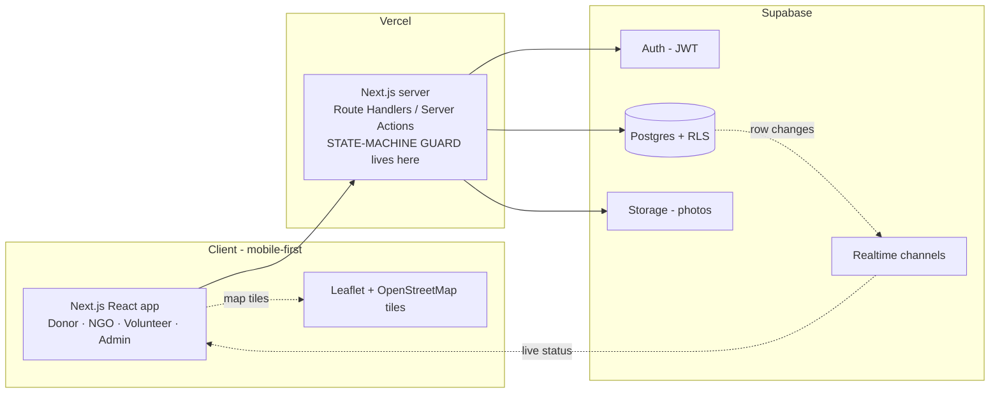
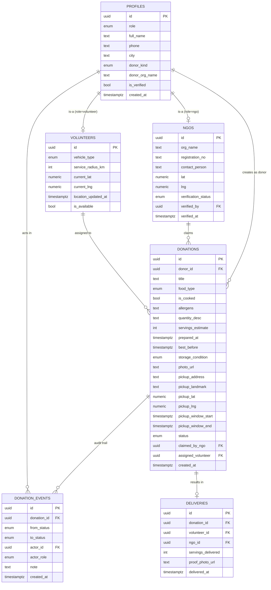
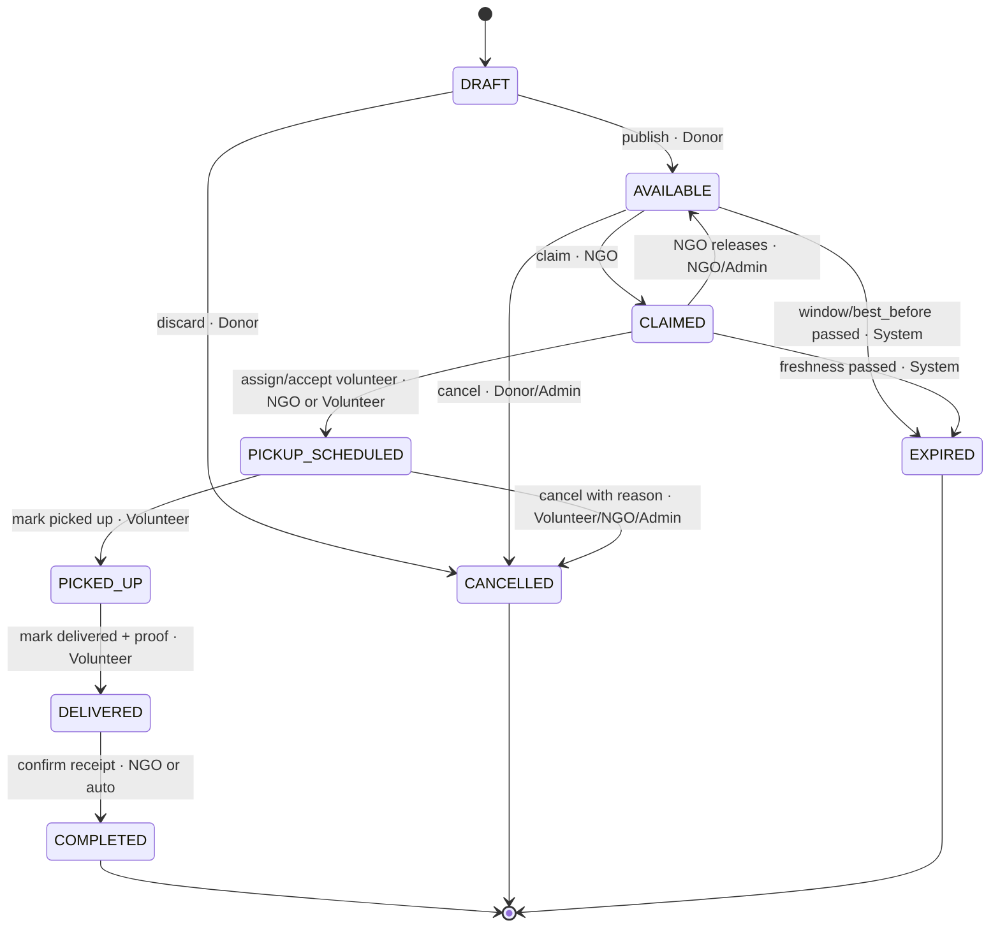
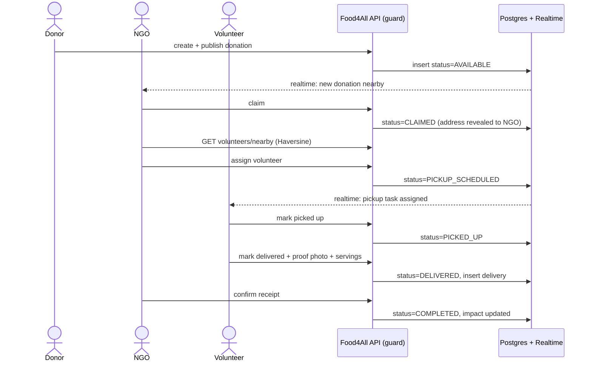

# Food4All — Phase 2: Architecture & Database Design

**Bridging Waste & Hunger**
Prepared for: Harsh Tiwari · Model: nonprofit / volunteer-driven · Date: September 2026
Follows: *Food4All Phase 1 — Competitive & Landscape Research*

---

## 0. What this document is

Phase 1 decided the *strategy*: be the volunteer-dispatch platform the Robin Hood Army never built, using the **Food Rescue Hero** product pattern — **donation → claim → dispatched volunteer → tracked delivery** — starting with a **campus pilot** and growing into **event/wedding surplus** in one city.

This document turns that into a *buildable engineering plan*: the tech stack, the data model, the donation state machine that is the heart of the system, who is allowed to do what, and the API surface. It is intentionally stack-agnostic at the data layer, so the same design works whether you build on the recommended stack or on MERN / Java if your college mandates one.

**MVP scope (from Phase 1 — repeated so the build stays disciplined):**

| Build first | Do NOT build yet |
|---|---|
| Auth with 4 roles (Donor, NGO, Volunteer, Admin) | Payments / paid marketplace |
| Mobile create-donation flow | Route optimisation, ML matching, chatbot |
| Donation list + detail with distance | Paid SMS / WhatsApp APIs |
| Claim / assign + **server-enforced state machine** | Multi-city, cold chain, warehousing |
| Volunteer pickup view + status updates | Gamification, social feed |
| Admin dashboard + **real impact counters** | |
| Location (address + landmark + lat/lng), **no paid map APIs** | |

---

## 1. Tech stack decision

**Recommended: Next.js (App Router) + Supabase + Leaflet/OpenStreetMap**, deployed on Vercel + Supabase free tiers.

| Concern | Choice | Why |
|---|---|---|
| Frontend + server | **Next.js (React)** | One codebase, mobile-first UI, Route Handlers/Server Actions for the API, free on Vercel |
| Database | **Supabase Postgres** | Relational — a perfect fit for roles, a strict state machine, and impact reporting via SQL |
| Auth + roles | **Supabase Auth + Row-Level Security (RLS)** | Role-based access enforced *in the database*, not just the UI |
| File storage | **Supabase Storage** | Food photos + delivery proof |
| Live updates | **Supabase Realtime** | Live volunteer dispatch + status without building a socket server |
| Maps | **Leaflet + OpenStreetMap** | No API key, no billing (solves the "no paid map APIs" constraint) |
| Geocoding | **Nominatim (OSM)** or manual pin-drop | Free address → lat/lng |
| Distance | **Haversine formula** | Nearest-volunteer matching in pure SQL/JS, no paid API |
| Directions | **Google/OSM deep-link URL** | Open external maps for turn-by-turn — free, no embed |

> **If your college mandates MERN or Java/Spring:** keep this exact data model and state machine. Replace Postgres+RLS with MongoDB + app-level guards (or Postgres + JPA), and Realtime with Socket.io. The design below is the contract; the framework is an implementation detail.

---

## 2. System architecture



**Golden rule:** every state change goes through **one guarded server function**. The UI never writes `status` directly; RLS blocks it even if someone tries. This single choke-point is what makes the state machine trustworthy — and it is exactly the kind of engineering rigor a final-year panel looks for.

---

## 3. Roles & personas

| Role | Who | Core actions |
|---|---|---|
| **Donor** | Individual, restaurant, hotel, banquet/wedding organiser | Create & publish a donation, cancel before pickup, see status of own donations |
| **NGO** | Shelter, community kitchen, verified charity (the *receiving* side) | Browse available donations, claim, assign/approve a volunteer, confirm receipt |
| **Volunteer** | "Robin"-style local helper who moves the food | See/accept a pickup task, navigate, mark picked-up & delivered with proof |
| **Admin** | Food4All core team | Verify NGOs & volunteers, moderate, resolve disputes, view global impact |

---

## 4. Data model (ER diagram)



### 4.1 Enums (single source of truth)

```sql
create type user_role          as enum ('donor','ngo','volunteer','admin');
create type donor_kind         as enum ('individual','restaurant','hotel','banquet','other');
create type food_type          as enum ('veg','nonveg','vegan','jain');       -- veg/nonveg is MANDATORY, culturally essential
create type storage_condition  as enum ('room','refrigerated','hot_held');
create type verification_status as enum ('pending','verified','rejected');
create type donation_status    as enum
  ('draft','available','claimed','pickup_scheduled','picked_up','delivered','completed','cancelled','expired');
```

### 4.2 Central table (reference DDL)

```sql
create table donations (
  id                  uuid primary key default gen_random_uuid(),
  donor_id            uuid not null references profiles(id),
  title               text not null,
  description         text,
  food_type           food_type not null,               -- MANDATORY (FSSAI + cultural)
  is_cooked           boolean not null default true,
  allergens           text,
  quantity_desc       text not null,
  servings_estimate   int check (servings_estimate >= 0),
  prepared_at         timestamptz,                       -- MANDATORY when is_cooked
  best_before         timestamptz not null,              -- MANDATORY, drives EXPIRED
  storage_condition   storage_condition not null default 'room',
  photo_url           text,
  pickup_address      text not null,
  pickup_landmark     text,
  pickup_lat          numeric(9,6) not null,
  pickup_lng          numeric(9,6) not null,
  pickup_window_start timestamptz not null,
  pickup_window_end   timestamptz not null,
  status              donation_status not null default 'draft',
  claimed_by_ngo      uuid references ngos(id),
  assigned_volunteer  uuid references volunteers(id),
  created_at          timestamptz not null default now(),
  updated_at          timestamptz not null default now(),
  check (prepared_at is null or prepared_at <= best_before),
  check (pickup_window_start < pickup_window_end)
);

create index on donations (status);
create index on donations (pickup_lat, pickup_lng);   -- bounding-box prefilter for nearest-volunteer
create index on donations (claimed_by_ngo);
create index on donations (assigned_volunteer);
```

### 4.3 Audit trail (why it matters)

`donation_events` records every transition (from → to, actor, timestamp, note). This one table gives you: a tamper-evident history, the raw data for the impact dashboard, easy debugging, and a strong talking point in your viva ("every state change is logged and attributable").

> **Location upgrade path:** for a bigger city rollout, swap the lat/lng columns for PostGIS `geography` + a GiST index and use `ST_DWithin` for true radius queries. For the MVP, a bounding-box prefilter + Haversine is free and fast enough.

---

## 5. Donation state machine (the core)



### 5.1 Transition table (the contract the guard enforces)

| # | From | To | Trigger role | Guard / condition | Side-effects |
|---|---|---|---|---|---|
| 1 | `draft` | `available` | Donor (owner) | all mandatory fields present; `best_before` in future | visible to NGOs; Realtime ping |
| 2 | `draft` | `cancelled` | Donor (owner) | — | — |
| 3 | `available` | `claimed` | NGO (verified) | not expired | set `claimed_by_ngo`; reveal exact address to that NGO |
| 4 | `available` | `cancelled` | Donor (owner) / Admin | — | — |
| 5 | `available` | `expired` | System (cron) | `now > best_before` **or** `now > pickup_window_end` | — |
| 6 | `claimed` | `pickup_scheduled` | NGO / Volunteer | volunteer available | set `assigned_volunteer`; reveal address to volunteer; Realtime ping |
| 7 | `claimed` | `available` | NGO / Admin | — | clear `claimed_by_ngo` |
| 8 | `claimed` | `expired` | System (cron) | freshness passed | — |
| 9 | `pickup_scheduled` | `picked_up` | **assigned** Volunteer only | — | timestamp |
| 10 | `pickup_scheduled` | `cancelled` | assigned Volunteer / NGO / Admin | reason required | — |
| 11 | `picked_up` | `delivered` | **assigned** Volunteer only | proof photo + servings required | create `deliveries` row |
| 12 | `delivered` | `completed` | claiming NGO (or auto after N hrs) | — | finalise impact counters |

Everything not in this table is **rejected**. That is the whole point.

### 5.2 One guard to rule them all (implementation sketch)

```ts
// server-side only — the UI never sets status directly
const TRANSITIONS: Record<Status, Status[]> = {
  draft:            ['available', 'cancelled'],
  available:        ['claimed', 'cancelled', 'expired'],
  claimed:          ['pickup_scheduled', 'available', 'expired'],
  pickup_scheduled: ['picked_up', 'cancelled'],
  picked_up:        ['delivered'],
  delivered:        ['completed'],
  completed: [], cancelled: [], expired: [],
};

async function transition(donationId, to, actor) {
  const d = await getDonation(donationId);
  if (!TRANSITIONS[d.status].includes(to)) throw new Error(`Illegal ${d.status} → ${to}`);
  assertRoleAllowed(d, to, actor);          // per the transition table
  assertGuards(d, to);                      // freshness, proof, ownership...
  await withTransaction(async (tx) => {
    await tx.updateStatus(donationId, to, sideEffects(d, to, actor));
    await tx.logEvent(donationId, d.status, to, actor);   // audit trail
  });
  // Realtime broadcast happens automatically on the row change
}
```

> In Postgres you can push this even harder: a `before update` trigger that raises an exception on an illegal transition, so the rule holds *even if someone bypasses the app*.

---

## 6. Role-permission matrix

✓ = allowed · **own** = only their own records · **asgn** = only if assigned/claiming · ✗ = denied

| Action | Donor | NGO | Volunteer | Admin |
|---|:--:|:--:|:--:|:--:|
| Create / edit / publish donation | ✓ own | ✗ | ✗ | ✓ |
| View list of *available* donations | ✗ | ✓ | ✓ | ✓ |
| View **exact** pickup address | ✓ own | ✓ asgn (after claim) | ✓ asgn (after assign) | ✓ |
| View **approx** location only | — | before claim | before assign | — |
| Claim a donation | ✗ | ✓ | ✗ | ✓ |
| Assign / approve a volunteer | ✗ | ✓ | self-accept | ✓ |
| Mark picked-up / delivered | ✗ | ✗ | ✓ asgn | ✓ |
| Confirm receipt (→ completed) | ✗ | ✓ claiming | ✗ | ✓ |
| Cancel | ✓ own, pre-pickup | ✓ claimed | ✓ asgn, w/ reason | ✓ any |
| Verify NGO / volunteer | ✗ | ✗ | ✗ | ✓ |
| View **global** impact dashboard | ✗ | ✗ | ✗ | ✓ |
| View **own** stats | ✓ | ✓ | ✓ | ✓ |
| Manage users | ✗ | ✗ | ✗ | ✓ |

**Privacy rule (from Phase 1 risks):** a donor's exact address and phone are **masked** until a pickup is assigned. Implement as a Postgres *view* `donations_public` that returns an approximate location (rounded lat/lng or an area name) and nulls the address/phone unless the requester is the donor, the claiming NGO, the assigned volunteer, or an admin. RLS enforces it; the UI can't leak it.

---

## 7. API surface

Presented REST-style so it maps cleanly onto Next.js Route Handlers *or* an Express/Spring backend. All writes that change `status` funnel through the guard in §5.2.

| Domain | Method & path | Role | Purpose |
|---|---|---|---|
| **Me** | `GET /api/me` | any | current profile + role |
| | `PATCH /api/me` | any | update profile |
| **Onboard** | `POST /api/ngos` | ngo | submit org details (→ pending) |
| | `PATCH /api/volunteers/me` | volunteer | vehicle, radius, availability |
| | `PATCH /api/volunteers/me/location` | volunteer | update current lat/lng |
| **Donations** | `POST /api/donations` | donor | create draft |
| | `PATCH /api/donations/:id` | donor(own) | edit draft |
| | `POST /api/donations/:id/publish` | donor(own) | draft → available |
| | `GET /api/donations` | ngo/volunteer/admin | list, filters: `status,city,food_type,lat,lng,radius` |
| | `GET /api/donations/:id` | scoped | detail (address masked per §6) |
| | `POST /api/donations/:id/claim` | ngo | available → claimed |
| | `POST /api/donations/:id/assign` | ngo/admin | claimed → pickup_scheduled `{volunteer_id}` |
| | `POST /api/donations/:id/accept` | volunteer | claimed → pickup_scheduled (self) |
| | `POST /api/donations/:id/pickup` | volunteer(asgn) | pickup_scheduled → picked_up |
| | `POST /api/donations/:id/deliver` | volunteer(asgn) | picked_up → delivered `{proof, servings}` |
| | `POST /api/donations/:id/complete` | ngo(claiming) | delivered → completed |
| | `POST /api/donations/:id/cancel` | role-guarded | → cancelled `{reason}` |
| **Matching** | `GET /api/volunteers/nearby` | ngo/admin | Haversine on `lat,lng,radius` |
| **Impact** | `GET /api/impact/summary` | admin(global)/any(own) | meals, pickups, kg, partners |
| **Admin** | `POST /api/admin/verify` | admin | verify/reject NGO or volunteer |
| | `GET /api/admin/users` | admin | manage users |
| **System** | *(cron)* `expireDonations()` | system | mark past-freshness rows `expired` |

**Realtime:** clients subscribe to a Supabase channel on `donations`. When the guard changes a row, NGOs see new available donations and volunteers see assigned tasks update live — no polling.

### 7.1 Nearest-volunteer query (free, no map API)

```sql
-- bounding-box prefilter (uses the lat/lng index) then exact Haversine
select v.*,
  6371 * acos(
    cos(radians(:lat)) * cos(radians(v.current_lat)) *
    cos(radians(v.current_lng) - radians(:lng)) +
    sin(radians(:lat)) * sin(radians(v.current_lat))
  ) as distance_km
from volunteers v
where v.is_available
  and v.current_lat between :lat - :d and :lat + :d      -- :d ≈ radius/111
  and v.current_lng between :lng - :d and :lng + :d
order by distance_km asc
limit 10;
```

---

## 8. Happy-path flow (donation → served meal)



---

## 9. Food safety & FSSAI alignment (bake it into the schema)

- **Mandatory fields:** `food_type` (veg/non-veg shown prominently — culturally essential in India), `prepared_at` (for cooked food), `best_before`, `storage_condition`.
- **Hard freshness window:** cooked food auto-`expired` once `now > best_before` (a cron job flips it) — a donation can never be claimed past its safe window.
- **Positioning:** Food4All is a **coordination platform, not a guarantor** of safety (India has no US-style Good Samaritan liability shield). Show a clear disclaimer at claim time.
- **Data fields mirror FSSAI "Save Food, Share Food"** guidance so the project reads as domain-aware — a real credibility win in evaluation.

---

## 10. Impact metrics (instrument from day one)

Real, verifiable counters — never invented figures; label any seed data as *demo*.

```sql
create view impact_summary as
select
  count(*) filter (where status = 'completed')            as donations_completed,
  coalesce(sum(dl.servings_delivered), 0)                 as meals_served,
  count(distinct d.assigned_volunteer)                    as active_volunteers,
  count(distinct d.claimed_by_ngo)                        as partner_ngos,
  count(*) filter (where status = 'expired')              as missed_expired   -- honesty metric
from donations d
left join deliveries dl on dl.donation_id = d.id;
```

Surface these on the Admin dashboard **and** the public landing page. Tracking `missed/expired` too (not just successes) signals integrity — panels notice that.

---

## 11. Deployment & cost (nonprofit-friendly)

| Piece | Host | Cost |
|---|---|---|
| Next.js app + API | Vercel | Free tier |
| Postgres + Auth + Storage + Realtime | Supabase | Free tier |
| Map tiles | OpenStreetMap | Free (respect usage policy; cache tiles) |
| Freshness-expiry cron | Supabase `pg_cron` **or** Vercel Cron | Free |

> Free-tier limits (row counts, storage, bandwidth) change over time — **verify the current numbers on vercel.com and supabase.com before you rely on them**, consistent with the Phase 1 "verify every figure" rule. Both are comfortably enough for a campus pilot.

---

## 12. Open decisions (settle these before building)

1. **Volunteer model:** NGO *assigns* a specific volunteer, or volunteers *self-accept* from an open pool? (Recommend: **self-accept** for the campus pilot — matches RHA's grassroots feel and dodges the assignment bottleneck; keep NGO-assign as an admin override.)
2. **Auto-complete:** if the NGO doesn't confirm receipt, auto-`completed` after N hours from `delivered`? (Recommend yes, N = 24h, logged.)
3. **Location precision** for privacy masking: round lat/lng to ~1 km, or show only an area/locality name pre-assignment?
4. **WhatsApp:** piggyback on existing volunteer WhatsApp groups (deep-link, free) vs in-app notifications only for the MVP.
5. **PostGIS** now or later (recommend later — Haversine is enough for one campus/city).

---

## 13. Next steps

1. Lock the 5 open decisions above.
2. Set up the Supabase project: enums → tables → RLS policies → the `donations_public` view.
3. Scaffold the Next.js app with role-aware auth.
4. Implement the **guarded `transition()`** first — it is the backbone; every screen plugs into it.
5. Build the donation lifecycle end-to-end for **one role at a time** (Donor → NGO → Volunteer → Admin).
6. Wire the impact view into the Admin dashboard + landing page.
7. Run the **campus pilot**: seed 3–5 NGOs/receivers + a core volunteer group *before* onboarding donors.

---

*Prepared as Phase 2 of the Food4All build. Next: scaffold the MVP against this design.*
